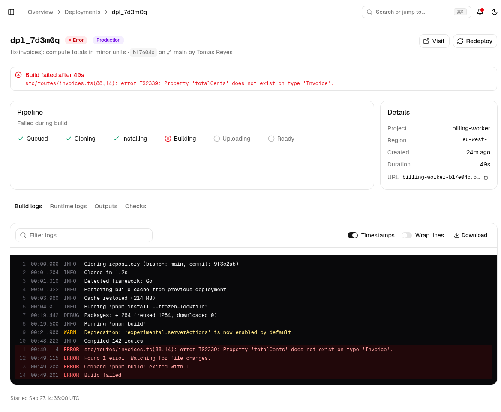
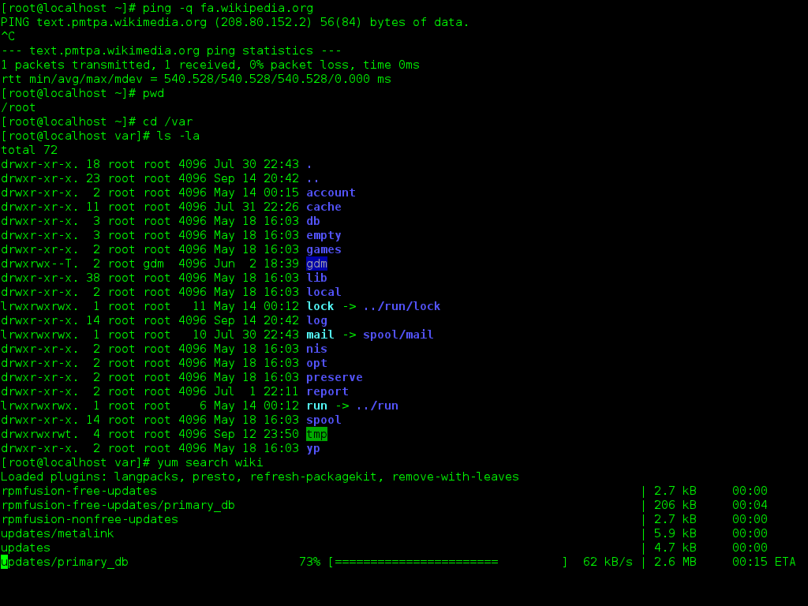

Every deployment keeps its complete build output. Open a deployment and stay on the **Build logs** tab.

## Reading a failed build

When a build fails, the deployment page shows a red banner with the first error line, and the log panel highlights every `ERROR` line in red. Warnings are amber; `DEBUG` lines are dimmed.

<Frame caption="The banner repeats the first error. The Build logs toolbar holds Filter logs, Timestamps, Wrap lines, and Download.">
  
</Frame>

Common failure patterns:

| Log line | Likely cause |
| --- | --- |
| `error TS2339` / `error TS2322` | A type error. Run `tsc --noEmit` locally to reproduce (see below) |
| `Command "… build" exited with 1` | The build script failed; look at the lines immediately above |
| `ERR_PNPM_OUTDATED_LOCKFILE` | `pnpm-lock.yaml` is out of date; run `pnpm install` and commit |
| `Module not found` | A dependency is missing from `package.json` or the import path is wrong on a case-sensitive filesystem |
| `Build exceeded maximum duration` | The build ran past 45 minutes. Check for a hung step or enable caching |

### Reproducing locally

Most build failures reproduce in a plain terminal with the same command Orbit ran. Check the **Build command** in [project settings](/projects/settings) and run it from the repository root.

<Frame caption="A GNOME Terminal session. Any shell works; Orbit builds run under bash on Linux. Image: Wikimedia Commons, GPL.">
  
</Frame>

## Toolbar

- **Filter logs** — narrows to lines containing the text. The line numbers keep their original values so you can reference them.
- **Timestamps** — toggles the elapsed-time column.
- **Wrap lines** — wraps long lines instead of scrolling horizontally.
- **Download** — saves the full, unfiltered log as `build-log.txt`.

## Live builds

While a deployment is **Building**, new lines append in real time and a spinner sits at the bottom of the panel. Queued deployments show "Waiting for build to start…" until a builder picks them up.

## Runtime logs

The **Runtime logs** tab links into the [Log explorer](/logs/explorer) pre-filtered to this deployment. Build logs and runtime logs are retained for 30 days on the Business plan.
