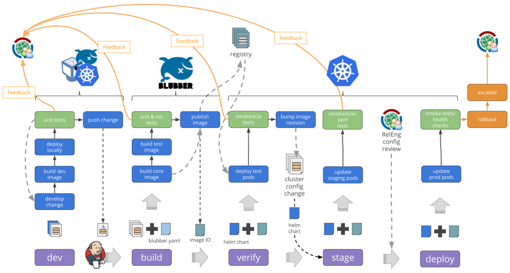

## How deployments are created

Orbit creates a deployment when:

- A commit is pushed to any branch of a connected repository
- You click **Deploy** or **Redeploy** in the dashboard
- The CLI runs `orbit deploy`
- An API key with `deployments:write` calls the deployments endpoint

<Frame caption="The general shape of a containerized continuous-delivery flow. Orbit implements the build, registry, and deploy stages for you. Diagram: Wikimedia Commons, CC BY-SA 2.5.">
  
</Frame>

Commits to the production branch become **production** deployments. Everything else is a **preview** with a URL like `atlas-web-git-feat-pricing-v2.orbit.app`. Projects can also define a **staging** branch in settings.

## Statuses

| Status | Meaning |
| --- | --- |
| **Queued** | Waiting for an available builder. Usually a few seconds |
| **Building** | Cloning, installing, and building. The pipeline shows the current stage |
| **Ready** | Build succeeded and is serving traffic |
| **Error** | The build or upload failed. See [build logs](/deployments/build-logs) |
| **Canceled** | Stopped manually or by auto-cancel when a newer commit arrived |

## The Deployments page

The organization-wide **Deployments** page lists builds across every project with filters for project, environment, and status, plus a search over commit messages, hashes, branches, and deployment IDs. Results are paginated eight per page.

Each project's **Deployments** tab shows the same data scoped to that project.

## Deployment detail

Click any deployment to open its detail page:

- **Pipeline** — the six stages with the current one highlighted. A failed stage shows a red icon.
- **Details** — project, region, timing, and the deployment URL with a copy button.
- **Build logs**, **Runtime logs**, **Outputs**, and **Checks** tabs.

**Outputs** lists every route the build produced with its type (static, edge function, Node function) and size. **Checks** shows the results of Lighthouse, bundle-size budget, type checking, and unit tests.

Header actions depend on state: **Visit**, **Redeploy**, **Promote to production** (previews only), **Rollback** (production only), and **Cancel build** while queued or building.

## Deployment IDs

IDs look like `dpl_8f2k1a` and are stable forever. They appear in webhooks, the audit log, and CLI output, and you can search for them on the Deployments page or paste them into the command palette.
