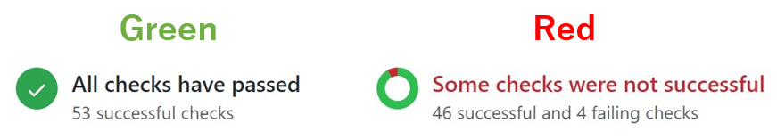

## Rollback

Because every deployment is immutable, rolling back means pointing production at an older **Ready** build. Nothing is rebuilt.

1. Open the project's **Overview** tab or the deployment you want to restore.
2. Click **Rollback**. From the Overview tab this restores the previous production deployment; from a deployment page it restores that specific build.
3. Traffic switches within a few seconds. The rollback is recorded in the [audit log](/organization/audit-log) as `deployment.rollback`.

<Note>
Rolled-back deployments keep the environment variables they were originally built with. If you rolled back because of a bad variable, fix the variable and redeploy instead.
</Note>

## Promote a preview to production

If a preview deployment is exactly what you want in production, you can promote it instead of merging and waiting for a new build.

1. Open the preview deployment.
2. Click **Promote to production** and confirm.

The build artifacts are reused, but **production** environment variables are applied at promotion time, so functions that read secrets pick up the production values.

## Redeploy

**Redeploy** rebuilds the same commit from scratch, using current environment variables and no cache. Use it after changing variables or when you suspect a flaky build.

## Gate merges on Orbit checks

Orbit reports each deployment's **Checks** (Lighthouse, bundle budget, type check, unit tests) back to GitHub as commit statuses. Mark them as required in your repository's branch protection rules so a red build can't be merged into the production branch in the first place.

<Frame caption="GitHub's merge box with required status checks passing versus failing. Image: Wikimedia Commons, CC BY-SA 4.0.">
  
</Frame>

## Canceling

A **Queued** or **Building** deployment can be canceled from its page. With **Auto-cancel superseded builds** enabled in [project settings](/projects/settings), Orbit cancels older queued builds on the same branch automatically.
