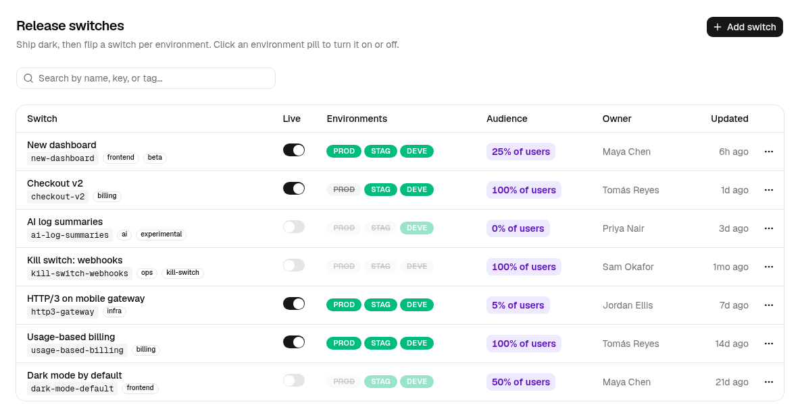

A feature flag is a named boolean (or string, number, or JSON value) that your code reads at runtime. Flags are evaluated at the edge in under a millisecond, and changes propagate globally within seconds.

## The flags table

Open **Flags** in the sidebar to reach the **Release switches** page. Each row shows the flag's name, key, tags, a master **Live** switch, one pill per environment, the audience percentage, owner, and last update.

Click an environment pill (**PROD**, **STAG**, or **DEVE**) to turn the flag on or off in that environment. A green pill means the flag is on there, and a struck-through gray pill means it's off. Environment pills are disabled while the **Live** switch is off.

<Frame caption="The Release switches table. When a flag's Live switch is off, its environment pills are grayed out.">
  
</Frame>

| Column | Meaning |
| --- | --- |
| **Live** | Master switch. Off means the flag serves its default (`false`) everywhere |
| **Environments** | Whether the flag is active in production, staging, and development |
| **Audience** | Percentage of users who receive `true` after targeting rules have been evaluated |

Search matches names, keys, and tags. Click a flag's name to open its detail sheet with the environment switches, targeting rules, and an SDK snippet.

## Creating a flag

Click **Add switch**. The **Create feature flag** dialog has three tabs:

1. **Basics** — name, key (auto-generated from the name as kebab-case), description, and type.
2. **Targeting** — ordered rules that serve a value to users matching an attribute. See [Targeting](/feature-flags/targeting).
3. **Rollout** — the percentage of remaining users who get `true`, and which environments to enable at creation.

The key can't be changed after creation because it's what your code references.

## Reading flags in code

```ts
import { orbit } from "@orbit/sdk";

const enabled = await orbit.flags.isEnabled("new-dashboard", {
  user: { id: user.id, plan: user.plan, email: user.email },
});
```

The attributes you pass are what [targeting rules](/feature-flags/targeting) evaluate against. Server SDKs cache flag definitions locally and re-validate every 10 seconds; edge and browser SDKs receive pushed updates.

## Kill switches

A common pattern is a flag that exists to be turned **off**, such as `kill-switch-webhooks`. Tag these `kill-switch` so they're easy to find from the command palette during an incident.

## Deleting a flag

Delete from the row menu. Deleting a flag makes SDK calls return the default value (`false`), so remove references from your code first. The deletion is recorded in the [activity history](/organization/audit-log).
