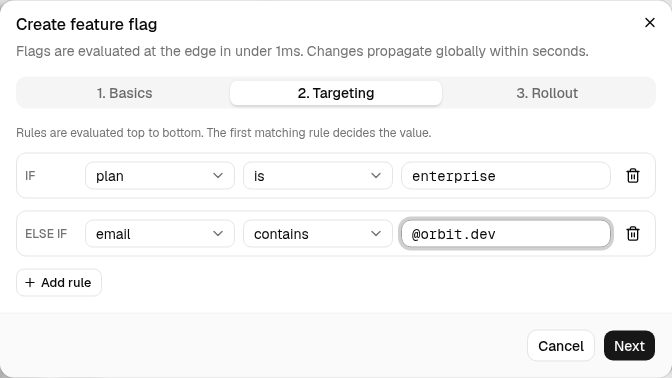

Targeting rules let you say "enterprise customers always get this" or "everyone at our own domain sees it first" without touching the rollout percentage.

## How evaluation works

Rules run top to bottom. The first rule whose condition matches decides the value. If no rule matches, the user falls through to the **percentage rollout**, where they are bucketed deterministically by ID so the same user always sees the same result.

```
IF      plan  is        "enterprise"      → serve true
ELSE IF email contains  "@orbit.dev"      → serve true
ELSE    → serve true to 25% of users
```

## Building rules

Open the **Targeting** tab in the create dialog (or the flag's detail sheet). Each rule has three parts:

| Part | Options |
| --- | --- |
| **Attribute** | `plan`, `email`, `country`, `platform`, `userId`, `orgId`, or any custom attribute your SDK passes |
| **Operator** | `is`, `is not`, `contains`, `starts with`, `is one of` |
| **Value** | A string; for `is one of`, a comma-separated list such as `US, CA, GB` |

Click **Add rule** for another row and the trash icon to remove one. Rules with an empty value are ignored when the flag is saved.

<Frame caption="Two rules matching the example above. The first rule is labeled IF and every later rule ELSE IF.">
  
</Frame>

## Attributes

Attributes come from the object you pass to the SDK:

```ts
orbit.flags.isEnabled("checkout-v2", {
  user: { id: "usr_18k3", plan: "enterprise", country: "US" },
});
```

Anything in `user` is available as an attribute. Values are compared as strings, case-insensitively.

## Environment overrides

Targeting rules are shared across environments, but each environment has its own on/off switch. A typical setup enables a flag in **development** and **staging** with no rules, then turns on **production** with a narrow rule set and a low rollout percentage.

## Testing a rule

The flag detail sheet shows the rules as they'll evaluate. To check a specific user, use the CLI:

```bash
orbit flags evaluate new-dashboard --user id=usr_18k3 plan=enterprise
# new-dashboard => true (rule 1: plan is "enterprise")
```
