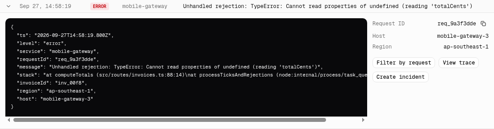

Orbit collects stdout, stderr, and structured log calls from every deployment and function invocation. The **Logs** page shows them in a single stream across all projects.

## Filtering

The filter bar combines four controls:

- **Search** matches message text and request IDs. Searching for a request ID such as `req_9a3f0000` shows every line from that request across services.
- **Levels** is a multi-select of `debug`, `info`, `warn`, and `error`, with counts for the current range.
- **Service** narrows to one project.
- **Time range** from the last 15 minutes to 7 days.

The header under the filter bar shows how many events match and whether the stream is **live** or **paused**.

## Live streaming

The **Live** button in the top right keeps the stream scrolling as new events arrive. Click it to **Pause** while you read; the existing rows stay in place and new events queue until you resume. Expanding a row pauses the stream automatically.

## Expanding a log line

Click any row to expand it. The left panel shows the full event as pretty-printed JSON, including structured fields your code attached (`invoiceId`, `durationMs`, stack traces). The right panel summarizes the request ID, host, and region and offers quick actions.

<Frame caption="An expanded error line. The JSON includes the structured fields the code attached, such as invoiceId and the stack trace.">
  
</Frame>

Quick actions:

| Action | Effect |
| --- | --- |
| **Filter by request** | Sets the search box to the request ID |
| **View trace** | Opens the distributed trace for the request |
| **Create incident** | Only on `error` lines; opens a new incident pre-filled with the message and a link back to the log |

## AI error summaries

**Summarize errors** groups the error lines in the current range into clusters and describes each in a sentence, so you can see "12 invoice total failures, 8 Kafka lag warnings, 5 Postgres reconnects" without scrolling. The feature is behind the `ai-log-summaries` [feature flag](/feature-flags/overview) during beta.

## Structured logging

Any JSON object written to stdout is parsed into fields. Orbit's SDKs add `requestId`, `service`, `region`, and `host` automatically:

```ts
import { log } from "@orbit/sdk";

log.error("Invoice total failed", { invoiceId: invoice.id, orgId: org.id });
```

Fields appear in the expanded JSON view and are searchable with `field:value` syntax, for example `invoiceId:inv_00f8`.

## Retention

| Plan | Retention |
| --- | --- |
| Team | 7 days |
| Business | 30 days |
| Enterprise | 90 days, or forward to your own warehouse via the Datadog or S3 integration |
