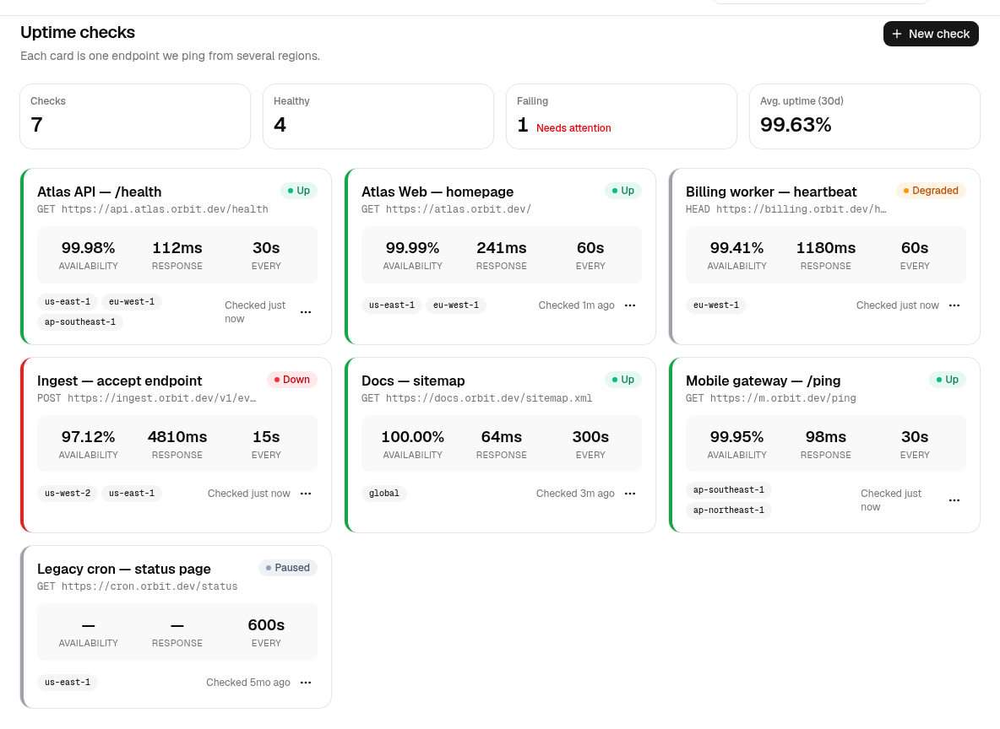

A monitor requests a URL on a schedule from the regions you choose and alerts when the response is wrong, slow, or missing.

## The Monitors page

Click **Monitors** in the sidebar to open the **Uptime checks** page. Summary cards show the total number of checks, how many are **Healthy** or **Failing**, and average 30-day uptime. Each monitor has its own card with its status, **Availability** (30-day uptime), **Response** (average latency), how often it runs (**Every**), its regions, and when it was last checked. Click a card for the detail page; the card menu offers **Pause**/**Resume**, **Run check now**, and **Delete**.

<Frame caption="The Uptime checks page. The Failing card flags monitors that need attention, and each card shows its status badge, key metrics, and regions.">
  
</Frame>

| Status | Meaning |
| --- | --- |
| **Up** | The last check passed in every region |
| **Degraded** | Passing, but latency exceeded the threshold |
| **Down** | Failed the configured number of consecutive checks |
| **Paused** | Not running; no alerts |

## Creating a monitor

Click **New check** to open the four-step wizard. **Continue** stays disabled until the current step is valid.

<Steps>
  <Step title="Endpoint">
    Name, HTTP method, and URL. **Advanced request options** expands to add headers, a request body for `POST`, and toggles for following redirects and verifying TLS certificates.
  </Step>
  <Step title="Schedule & regions">
    Check interval (15 seconds to 5 minutes) and one or more regions. Intervals under a minute require the Business plan.
  </Step>
  <Step title="Alert conditions">
    Expected status code, consecutive failures before alerting, a latency threshold, an optional string the body must contain, and which channels to notify. **Escalate if unacknowledged** pages the secondary on-call after a delay you choose.

  </Step>
  <Step title="Review">
    A summary of everything above. Click **Create monitor**; the first check runs within a minute.
  </Step>
</Steps>

## Alert channels

| Channel | Configured in |
| --- | --- |
| Slack channels | [Settings → Integrations](/organization/settings#integrations) |
| PagerDuty | Settings → Integrations |
| Email | Sends to the organization's ops address |
| Webhook | Any [webhook endpoint](/organization/webhooks) subscribed to `monitor.down` |

When a monitor goes **Down**, Orbit also opens an [incident](/monitoring/incidents) with the failing regions and response code, and resolves it automatically when the monitor recovers.

## Monitor detail

The detail page charts response time over 24 hours and daily uptime over 30 days, lists the most recent checks per region with status and latency, and shows the configuration. **Run check now** triggers an immediate check in every region.

## Limits

| Plan | Monitors | Minimum interval | Regions |
| --- | --- | --- | --- |
| Team | 10 | 60s | 2 |
| Business | 25 | 15s | 6 |
| Enterprise | Unlimited | 10s | 6 + private locations |
