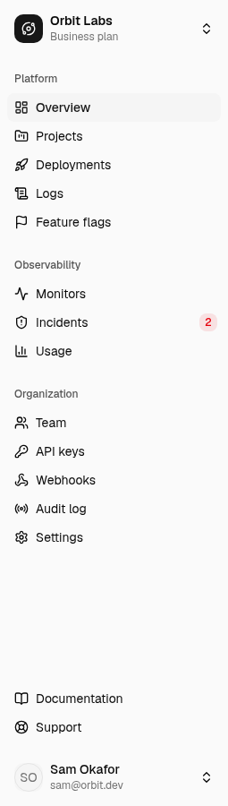

## Sidebar

The sidebar is grouped into three sections that mirror how Orbit is organized:

| Section | Pages |
| --- | --- |
| **Platform** | Overview, Projects, Deployments, Logs, Feature flags |
| **Observability** | Monitors, Incidents, Usage |
| **Organization** | Team, API keys, Webhooks, Audit log, Settings |

A red badge next to **Incidents** shows how many incidents are open or acknowledged. The organization switcher at the top lets you jump between organizations you belong to, and the footer menu holds account settings, billing, and sign out.

<Frame caption="The sidebar groups pages into Platform, Observability, and Organization. The red badge on Incidents counts open and acknowledged incidents.">
  
</Frame>

Press <kbd>⌘</kbd> <kbd>B</kbd> (or <kbd>Ctrl</kbd> <kbd>B</kbd>) to collapse the sidebar to icons. Hover an icon to see its label. On narrow screens the sidebar becomes a slide-over sheet behind the button in the top-left corner.

## Command palette

Press <kbd>⌘</kbd> <kbd>K</kbd> anywhere (or click the search field in the header) to open the command palette. It searches projects and feature flags by name or key, lists every page, and exposes quick actions such as **Create monitor** and **Toggle dark mode**.

Use the arrow keys to move and <kbd>Enter</kbd> to select. <kbd>Esc</kbd> closes it.

<Note>Screenshot needed: the command palette open over the Overview page, showing the Actions, Projects, and Feature flags groups.</Note>

## Header

- **Breadcrumbs** on the left always lead back to the Overview page.
- The **bell** shows notifications for open incidents, failed deployments, and accepted invitations.
- The **moon/sun** button toggles dark mode for your account. Charts, code panels, and status badges all have dark variants.

## Keyboard shortcuts

| Shortcut | Action |
| --- | --- |
| <kbd>⌘</kbd> <kbd>K</kbd> | Open command palette |
| <kbd>⌘</kbd> <kbd>B</kbd> | Collapse or expand the sidebar |
| <kbd>Esc</kbd> | Close any dialog, sheet, or menu |
| <kbd>Enter</kbd> in a table search field | Apply the filter |

<Note>
On Windows and Linux, substitute <kbd>Ctrl</kbd> for <kbd>⌘</kbd>.
</Note>
