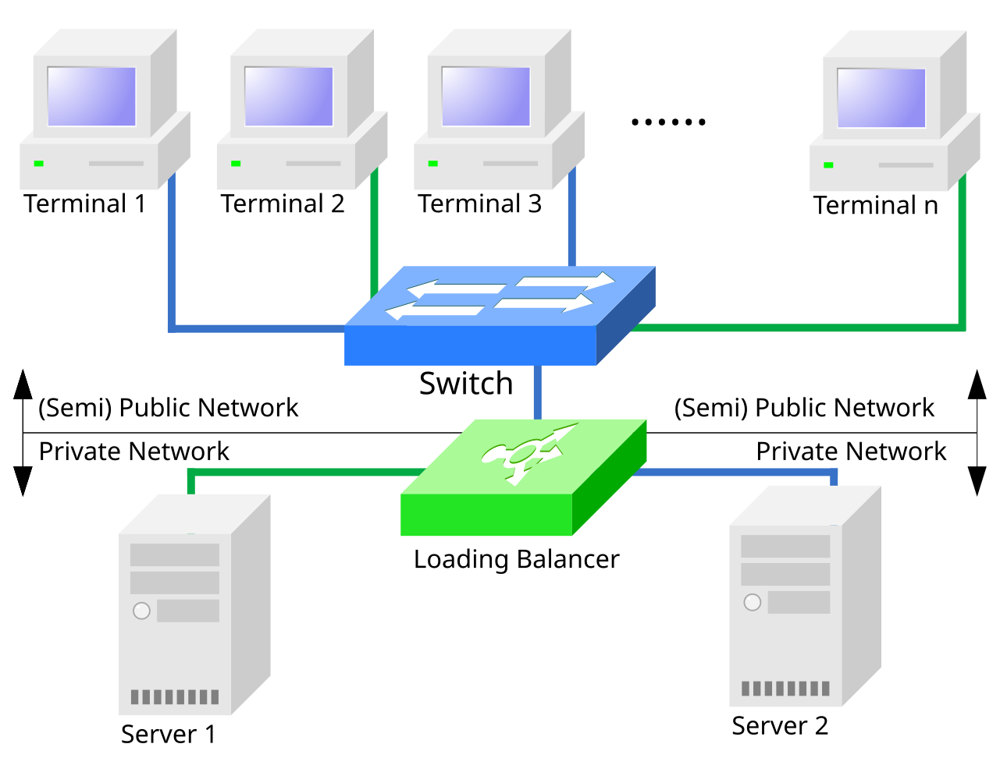

Every project is reachable at `<slug>.orbit.app` from its first deployment. The **Domains** tab is where you add hostnames you own.

## Add a domain

1. Click **Add domain** and enter the hostname, for example `app.example.com` or the apex `example.com`.
2. Orbit shows the DNS record to create at your registrar:
   - Subdomains: a `CNAME` pointing to `cname.orbit.dev`
   - Apex domains: an `A` record pointing to `76.76.21.21`, or an `ALIAS`/`ANAME` if your provider supports it
3. Wait for verification. Orbit re-checks every minute; click **Refresh** to check immediately.

While a domain is unverified the table shows **Pending DNS** in amber. Hover it to see the exact record Orbit is looking for.

## How traffic reaches a deployment

Custom domains resolve to Orbit's anycast edge. Each edge location terminates TLS and load-balances requests across the healthy instances of your production deployment in the project's region, the same way a conventional NAT-based load-balancing cluster does.

<Frame caption="A NAT load-balancing cluster: one public address in front of several real servers. Diagram: Wikimedia Commons, CC BY-SA 4.0.">
  
</Frame>

## SSL

Certificates are issued through Let's Encrypt as soon as DNS verifies, then renewed automatically 30 days before expiry. The **SSL** column shows one of:

| State | Meaning |
| --- | --- |
| **Active** | A valid certificate is being served |
| **Pending** | DNS verified; certificate issuance in progress (usually under a minute) |
| **Failed** | Issuance failed, typically because the `_acme-challenge` record was removed or a CAA record blocks Let's Encrypt |

A failed renewal opens a low-severity [incident](/monitoring/incidents) automatically so it doesn't go unnoticed.

## Primary domain

One verified domain is marked **Primary**. It is the canonical URL shown across the dashboard and in webhooks, and other domains redirect to it with a `308`. To change the primary domain, open the row menu on another verified domain and choose **Set as primary**.

## Redirects and previews

Custom domains always point at the current production deployment. Preview deployments keep their generated `*.orbit.app` URLs; to give a branch a stable hostname, add a domain and assign it to that branch in the row menu.
