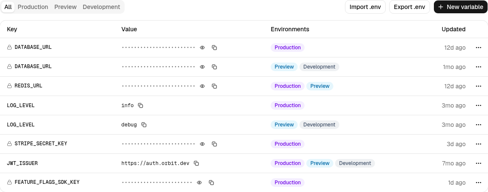

Environment variables live on the **Environment** tab of a project. Each variable has a key, a value, one or more target environments, and a **Sensitive** flag.

<Frame caption="Sensitive values are masked until you click the eye icon. The same key can appear twice with different environment targets.">
  
</Frame>

## Environments

| Environment | Used by |
| --- | --- |
| **Production** | Deployments from the production branch (`main` by default) |
| **Preview** | Deployments from every other branch and pull request |
| **Development** | `orbit dev` on your machine, via `orbit env pull` |

The same key can exist more than once with different environment targets, which is how you point production and preview at different databases. The filter tabs above the table narrow the list to one environment.

## Sensitive values

Variables marked **Sensitive** are masked in the table and omitted from API responses and exported `.env` files. Members with the **Developer** role or higher can reveal a value with the eye icon; each reveal is recorded in the [audit log](/organization/audit-log).

<Warning>
Revealed values are visible until you navigate away or click the eye icon again. Don't leave a revealed secret on screen during a screen share.
</Warning>

## Add or edit a variable

1. Click **New variable**, or open the row menu (⋯) and choose **Edit**.
2. Enter a key. Keys must match `[A-Z_][A-Z0-9_]*`; the field uppercases as you type and shows an inline error for invalid characters.
3. Paste the value. Multi-line values (certificates, JSON) are supported.
4. Choose the environments and whether the value is sensitive.
5. Click **Add variable** or **Save changes**.

Changes apply to the **next deployment** in each selected environment. Running deployments keep the values they were built with. Click **Deploy** on the project header to roll the new values out immediately.

## Import and export

**Import .env** adds variables from a dotenv file.

**Export .env** downloads a dotenv file for the currently filtered environment, with sensitive values redacted. Use the CLI (`orbit env pull --env development`) when you need real values locally.

## Limits

- 200 variables per project
- 64 KB per value
- Keys are case-sensitive and unique per environment
