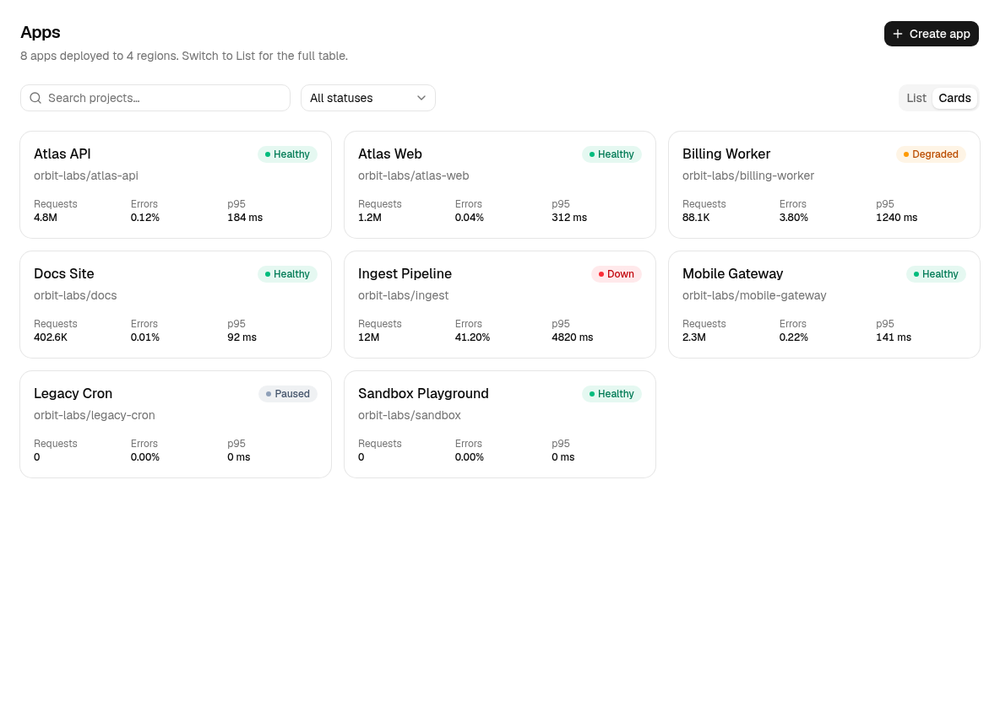

## The Apps page

The **Apps** page lists every project in the organization. It opens in the **Cards** view, where each card shows the project's health, repository, 24-hour requests, error rate, and p95 latency. Switch to **List** with the toggle on the right for the full table, which adds framework, region, and time since the last deployment. Search by name or filter by status in either view.

<Frame caption="The Apps page in the Cards view. Use the search box and status filter on the left, and the List and Cards toggle on the right.">
  
</Frame>

Project status is derived from monitors and error rates:

| Status | Meaning |
| --- | --- |
| **Healthy** | Monitors passing and error rate below 1% |
| **Degraded** | Latency or error rate above threshold, but the service is responding |
| **Down** | One or more production monitors failing in every region |
| **Paused** | Deployments and monitors are suspended; the project serves nothing |

Click any card or row to open the project. In the **List** view, the row menu (⋯) offers **Visit site**, **Redeploy**, and **Pause**/**Resume** without leaving the list.

## Inside a project

Each project has five tabs. You can deep-link to a tab with `?tab=<name>`, for example `/projects/atlas-api?tab=environment`.

<Tabs>
  <Tab title="Overview">
    Request volume, error rate, p95 latency, and 30-day uptime, alongside the current production deployment and the project's build configuration. If the project is **Down**, a red alert at the top links to the related incident.
  </Tab>
  <Tab title="Deployments">
    Every build for this project, newest first, with environment, status, duration, and author. Rows open the [deployment detail](/deployments/overview) page.
  </Tab>
  <Tab title="Environment">
    Environment variables scoped to production, preview, and development. See [Environment variables](/projects/environment-variables).
  </Tab>
  <Tab title="Domains">
    Custom hostnames, DNS verification status, and SSL state. See [Domains](/projects/domains).
  </Tab>
  <Tab title="Settings">
    Build configuration, deployment protection, and the danger zone. See [Project settings](/projects/settings).
  </Tab>
</Tabs>

## Header actions

- **Visit** opens the production URL in a new tab.
- **Deploy** queues a new production build from the production branch.
- The **⋯** menu contains **Purge cache**, **Pause project**, and **Delete project**, which jumps to the danger zone in Settings.

## Projects with no deployments

A freshly created project has no builds yet. The Deployments tab shows an empty state with a **Deploy now** button; pushing to the repository also triggers the first build.

